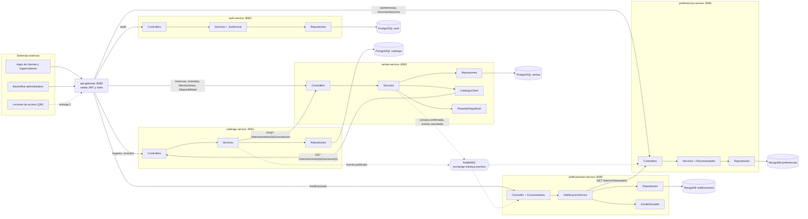
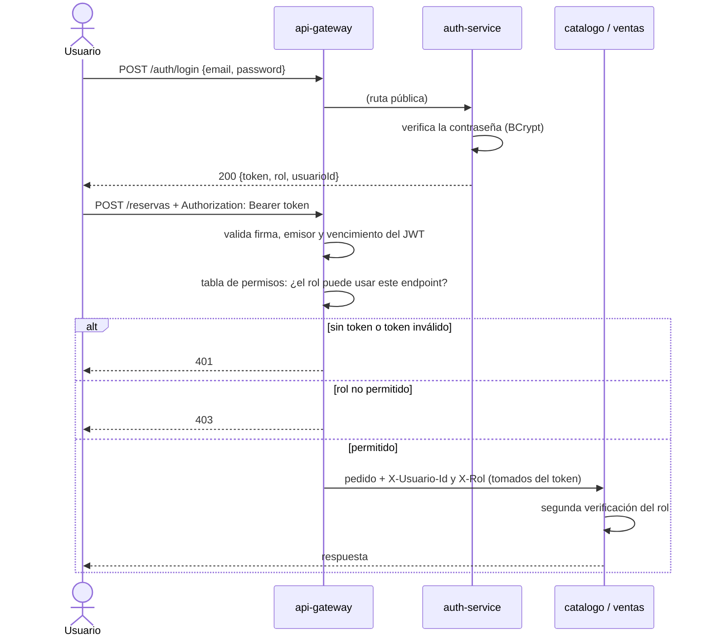
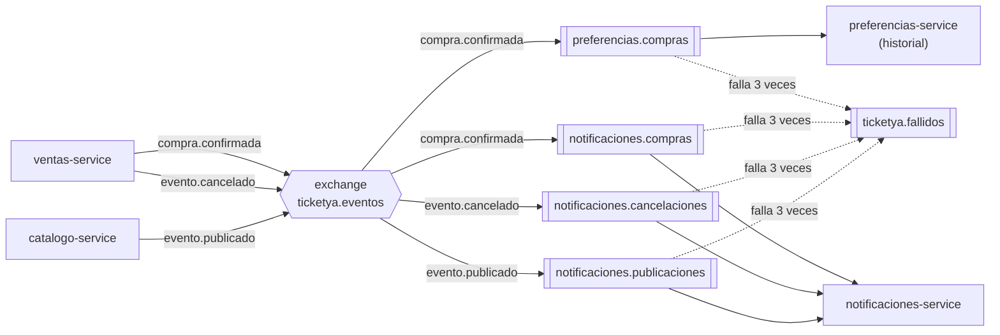

# TicketYa - Arquitectura de microservicios

## 1. Microservicios y responsabilidades

| Servicio | Puerto | Responsabilidad | Base de datos |
|---|---|---|---|
| **api-gateway** | 8080 | Punto de entrada único. Valida el JWT y los roles (entrega 2), enruta a los servicios, asigna un `X-Correlation-Id` a cada pedido y registra método, ruta, usuario, código de respuesta y tiempo. No publica las rutas `/interno/**`. | - |
| **auth-service** | 8083 | Usuarios y roles: registro de clientes, alta de usuarios con rol (admin) y login, que emite el JWT. *(entrega 2)* | `auth` |
| **preferencias-service** | 8084 | Preferencias de cada cliente (ciudad, tipos y artistas favoritos), historial de compras y recomendaciones de eventos. *(entrega 2)* | MongoDB `preferencias` |
| **notificaciones-service** | 8085 | Avisos a los clientes (email simulado): compra confirmada, evento cancelado y artista favorito en su ciudad. Se activa por mensajes de RabbitMQ. *(entrega 2)* | MongoDB `notificaciones` |
| **catalogo-service** | 8081 | Lugares, sectores y eventos: alta, precios por sector, publicación, suspensión, cancelación y búsqueda por múltiples criterios. Es el dueño de la verdad sobre qué se vende y a qué precio. | `catalogo` |
| **ventas-service** | 8082 | Reserva temporal de lugares, compra y pago (pasarela simulada), entradas con QR, devoluciones y cancelación de entradas. Garantiza que una entrada no se venda dos veces. | `ventas` |

**Por qué esta división:** catálogo se lee mucho y cambia poco (candidato a caché en la entrega 2), mientras que ventas
recibe mucha escritura concurrente sobre los mismos recursos. Separarlos permite escalar y proteger ventas de forma
independiente, y deja un lugar natural para sumar servicios en la entrega 2 (notificaciones, fila virtual,
recomendaciones y reportes).

Cada servicio tiene su propia base de datos y **no accede a la del otro**: lo que necesita lo pide por HTTP.
En Docker: auth, catálogo y ventas usan un PostgreSQL 16 cada uno (sin Docker, H2); preferencias y notificaciones
usan MongoDB, cada uno con su propia base dentro de la misma instancia. Los servicios se avisan cosas en forma
asincrónica a través de **RabbitMQ** (sección 11).

## 2. Diagrama de módulos

## 3. API pública (a través del gateway, `http://localhost:8080`)

| Servicio | Endpoints |
|---|---|
| auth | `POST /auth/registro`, `POST /auth/login`, `POST/GET /auth/usuarios` |
| catalogo | `POST/GET /lugares`, `GET /lugares/{id}`, `POST/GET /eventos`, `GET /eventos/{id}`, `PUT /eventos/{id}/precios`, `POST /eventos/{id}/publicacion`, `PUT /eventos/{id}/suspension`, `PUT /eventos/{id}/cancelacion` |
| preferencias | `GET/PUT /preferencias`, `GET /recomendaciones` |
| notificaciones | `GET /notificaciones` |
| ventas | `POST /reservas`, `GET/DELETE /reservas/{id}`, `POST /reservas/{id}/pago`, `GET /entradas`, `GET /entradas/{id}`, `POST/GET /devoluciones`, `PUT /devoluciones/{id}/aprobacion`, `PUT /devoluciones/{id}/rechazo`, `GET /disponibilidad/eventos/{e}/sectores/{s}` |

Detalle con ejemplos en [05-api-endpoints.md](05-api-endpoints.md) y en los OpenAPI de cada servicio.

**API interna** (solo entre servicios, el gateway no la publica):

| Quién llama | Endpoint | Para qué |
|---|---|---|
| ventas -> catalogo | `GET /interno/eventos/{eventoId}/sectores/{sectorId}` | Obtener estado del evento, fecha, capacidad y precio del sector. |
| catalogo -> ventas | `POST /interno/eventos/{eventoId}/cancelacion` | Avisar la cancelación para pasar las entradas a reintegro. |
| notificaciones -> preferencias | `GET /interno/interesados?ciudad=&artistas=` | Clientes de esa ciudad con alguno de esos artistas como favorito. |
| preferencias, notificaciones -> catalogo | `GET /eventos`, `GET /eventos/{id}` (públicos) | Eventos a la venta (candidatos a recomendar) y nombre/tipo/ciudad de un evento. |

## 4. Cómo se garantiza que una entrada no se venda dos veces

El control está **en la base de datos**, no en la memoria de una instancia. Por eso funciona aunque haya varias
instancias de ventas ejecutándose al mismo tiempo.

| Caso | Mecanismo |
|---|---|
| **Asiento numerado** | Restricción de unicidad sobre `(evento, sector, fila, número)` en `asiento_ocupado`. Si dos clientes intentan tomar el mismo asiento, la base rechaza al segundo y su transacción se deshace por completo. |
| **Zona sin asiento (cupo)** | Una fila de cupo por zona (`stock_zona`) que se modifica con bloqueo pesimista (`SELECT ... FOR UPDATE`): las compras esperan su turno y el cupo no puede quedar negativo. Es la alternativa "pesimista" indicada para mucha competencia por el mismo cupo. |
| **Reintento del cliente** | Cada pago lleva un `Idempotency-Key` único guardado con restricción de unicidad. Repetir el pago devuelve el resultado anterior sin cobrar otra vez. |
| **Pago en curso** | Al comenzar el cobro la reserva pasa a `EN_PAGO`: mientras tanto nadie puede liberar sus lugares aunque su plazo esté por vencer. |
| **Reservas vencidas** | Se liberan al reservar (los lugares de reservas vencidas más de 5 segundos). No hace falta un proceso aparte. |

Esto se prueba con tests que lanzan **20 clientes simultáneos** sobre el mismo asiento y sobre el último lugar de una zona
(`DobleVentaTest`).

## 5. Consistencia entre servicios (entrega 1)

Una cancelación de evento involucra a los dos servicios, y no existe una transacción de base de datos que los abarque:

1. Catálogo cambia el estado del evento a CANCELADO y **confirma su transacción**.
2. Recién después avisa a ventas por HTTP (**fuera de la transacción**, con timeouts de conexión y de lectura).
3. Ventas pasa las entradas a `A_REINTEGRAR` en **una única transacción**, de forma idempotente.
4. Si ventas no responde, el evento igual queda cancelado y la respuesta devuelve `reintegroNotificado: false`.

Lo mismo se aplica al pago: la llamada a la pasarela se hace **fuera** de toda transacción de base de datos, para no
mantener conexiones ni bloqueos tomados mientras se espera a un sistema externo. Las compensaciones automáticas (Saga),
los reintentos programados y el circuit breaker se completan en la entrega 2.

## 6. Decisiones y simplificaciones de la entrega 1

| Tema | Decisión |
|---|---|
| Autenticación | Entrega 1: sin JWT (`X-Usuario-Id` y `X-Rol`). Entrega 2: JWT con roles, ver sección 9. |
| Pasarela de pagos | Simulada (`PasarelaPagoMock`): rechaza los medios de pago cuyo nombre contiene "RECHAZ" y aprueba el resto. |
| Bases de datos | Una base por servicio, esquemas separados: PostgreSQL (H2 en desarrollo) para auth, catálogo y ventas; MongoDB para preferencias y notificaciones. Justificación en `04-modelo-de-datos.md`. |
| Reserva temporal | Vence a los 10 minutos (`ventas.reserva-minutos`). Máximo 4 entradas por cliente y evento (`ventas.max-entradas-por-evento`). |
| Orden por relevancia | No implementado (se sumará con las recomendaciones). Se puede ordenar por fecha o por precio. |
| Despliegue | Entrega 2: un contenedor por servicio y por base, todo con `docker-compose.yml` (ver sección 10). |

## 7. Limitaciones conocidas

- Si el servicio de ventas se cae justo mientras una reserva está `EN_PAGO`, la reserva queda en ese estado hasta que se
  resuelva manualmente. La entrega 2 lo resuelve con compensaciones.
- Si el pago ya se aprobó cuando se cancela el evento, la entrada se emite directamente en `A_REINTEGRAR` (hay una marca de
  evento cancelado para cubrir ese caso). Queda una ventana de milisegundos que también cubre la entrega 2.
- Si catálogo no logra avisar la cancelación a ventas, el aviso no se reintenta automáticamente todavía.
- Las llamadas entre servicios usan direcciones fijas (`localhost`); service discovery queda para la entrega 2.

## 8. Requisitos no funcionales y su entrega

| Requisito | Entrega |
|---|---|
| Arquitectura de microservicios Spring Boot independientes | E1 |
| API Gateway como punto de entrada único | E1 |
| API REST síncrona | E1 |
| Comunicación asíncrona donde se justifique | E2 (hecho: RabbitMQ para avisos e historial, sección 11) |
| Una base de datos por servicio | E1 |
| Concurrencia e idempotencia (doble venta) | E1 |
| Trazabilidad: registro de cada solicitud y `X-Correlation-Id` | E1 (parcial en el gateway), E2 (log centralizado) |
| Seguridad con JWT y roles | E2 (hecho) |
| Base NoSQL en al menos un servicio | E2 (hecho: MongoDB en preferencias y notificaciones) |
| Consistencia entre servicios y compensaciones | E2 |
| Resiliencia: reintentos, timeouts y fallback | E1 (timeouts), E2 (reintentos y fallback) |
| Caché de catálogo (y por qué no se cachea la disponibilidad) | E2 |
| Docker y docker-compose | E2 (hecho) |
| Prueba de carga | E2 |

## 9. Seguridad: JWT y roles (entrega 2)

**Roles:** `CLIENTE` (compra), `ORGANIZADOR` (crea lugares y eventos), `ADMIN` (gestión completa) y `ACCESO`
(personal que escanea los QR en el ingreso; se usará con el control de acceso).

| Decisión | Por qué |
|---|---|
| **Un servicio propio para usuarios** (`auth-service`) | Es el único que conoce contraseñas. Los demás servicios no guardan credenciales ni dependen de él en cada pedido. |
| **JWT firmado con HS256 y secreto compartido** con el gateway | El token se valida sin consultar a `auth-service` (no es un cuello de botella ni un punto único de falla en la apertura de una venta masiva). Con más servicios que validen tokens convendría RS256 (clave pública/privada). |
| **Validación centralizada en el gateway** (*gateway offloading*) | La autenticación se resuelve en un solo lugar. El gateway descarta los `X-Usuario-Id`/`X-Rol` que mande el cliente y los reemplaza por los del token, así nadie puede hacerse pasar por otro. |
| **Segunda verificación en cada servicio** (defensa en profundidad) | Si por error un pedido llegara sin pasar por el gateway, el servicio igual exige el rol correcto. Además, en Docker los servicios no publican puertos: solo el gateway es accesible desde afuera. |
| **Contraseñas con BCrypt** | Hash lento y con sal propia por usuario: un robo de la base no expone las contraseñas. |
| **Registro público siempre como CLIENTE** | Nadie puede auto-asignarse un rol: organizadores, personal de acceso y administradores los da de alta un ADMIN. |
| **Token de 60 minutos, sin refresh token** | Simplificación: alcanza para una compra completa. Revocar tokens antes de su vencimiento queda fuera del alcance. |

La tabla completa de permisos por endpoint está en el README y se verifica en `ReglasDeAccesoTest` (gateway) y
`SeguridadEndpointsTest` (catálogo y ventas).

**Limitación conocida:** todavía no se controla que un organizador solo modifique *sus* eventos (el organizador del evento
es un texto). Se puede resolver guardando el id del organizador al crear el evento.

## 10. Despliegue con Docker (entrega 2)

`docker compose up --build` levanta 11 contenedores en una red interna:

| Contenedor | Imagen | Puerto publicado |
|---|---|---|
| `api-gateway` | build de `api-gateway/Dockerfile` | **8080** (único punto de entrada) |
| `auth-service`, `catalogo-service`, `ventas-service` | build de su `Dockerfile` | ninguno |
| `auth-db`, `catalogo-db`, `ventas-db` | `postgres:16-alpine` (con volumen propio) | ninguno |
| `preferencias-service`, `notificaciones-service` | build de su `Dockerfile` | ninguno |
| `mongo` | `mongo:7.0.11` con `--auth` (configuración de la cátedra) | `127.0.0.1:27017` (solo local, para Compass) |
| `rabbitmq` | `rabbitmq:3.13-management` | `127.0.0.1:5672` y consola web `127.0.0.1:15672` (solo local) |

- Cada `Dockerfile` compila con Maven en una primera etapa y copia solo el jar a una imagen con el JRE (más liviana).
- Los servicios se comunican por el nombre del contenedor (`http://catalogo-service:8081`), configurado con variables
  de entorno; no hace falta cambiar código entre la ejecución local y Docker.
- Cada servicio espera a que su base esté lista (`healthcheck` con `pg_isready`).
- El mecanismo contra la doble venta funciona igual en PostgreSQL: la restricción de unicidad y el `SELECT ... FOR UPDATE`
  son de la base, no de H2.

## 11. Comunicación asincrónica con RabbitMQ (entrega 2)

Los avisos entre servicios que **no necesitan respuesta inmediata** viajan como mensajes por RabbitMQ, en lugar de
llamadas HTTP. Hay un único exchange de tipo *topic*, `ticketya.eventos`; cada mensaje lleva una clave y cada servicio
consumidor tiene **su propia cola** enlazada a las claves que le interesan.

| Mensaje | Lo publica | Cuándo | Lo consumen |
|---|---|---|---|
| `compra.confirmada` | ventas | Pago aprobado y entradas emitidas | preferencias (historial) y notificaciones (aviso al cliente) |
| `evento.cancelado` | ventas | Después de pasar a reintegro las entradas de un evento cancelado; lleva la lista de compradores | notificaciones (un aviso por comprador) |
| `evento.publicado` | catálogo | Un evento pasa a PUBLICADO | notificaciones (avisa a los fans de esos artistas en esa ciudad, consultando a preferencias) |

| Decisión | Por qué |
|---|---|
| **Asincrónico para avisos e historial** | La compra no espera a que se mande un email ni a que se actualice el historial. Si notificaciones o preferencias están caídos, los mensajes quedan en su cola y se procesan cuando vuelven: no se pierden ni frenan la venta. |
| **Sincrónico (HTTP) donde hace falta la respuesta** | Reservar necesita el precio y el estado del evento *ya*; la cancelación necesita confirmar el paso a reintegro. Esas llamadas siguen siendo REST. |
| **Publicar después del commit** (`@TransactionalEventListener(AFTER_COMMIT)`) | Solo se anuncia lo que realmente quedó guardado: si la transacción se deshace, no sale ningún mensaje. |
| **Fire-and-forget en el productor** | Si RabbitMQ no está disponible al publicar, la compra igual se completa y queda registrado en el log. *Limitación:* ese aviso se pierde; la solución completa es el patrón *Transactional Outbox* (guardar el mensaje en la misma transacción y enviarlo después). |
| **Consumidores idempotentes** | RabbitMQ garantiza entrega "al menos una vez": un mensaje puede llegar repetido. Preferencias ignora una compra ya registrada (`compraId`) y notificaciones tiene un índice único por aviso (`tipo:referencia:usuario`). |
| **Reintentos y cola de fallidos** | Si procesar un mensaje falla (por ejemplo, preferencias no responde), se reintenta 3 veces (1 s, 2 s) y luego va a `ticketya.fallidos` (*dead letter queue*) para revisarlo, en vez de reencolarse para siempre. |
| **Un contrato JSON, sin clases compartidas** | Cada servicio tiene su propio `record` del mensaje: solo comparten el formato, no una librería. Los microservicios se pueden desplegar por separado. |

**Consistencia:** el historial de preferencias y los avisos son **eventualmente consistentes**: aparecen unos
milisegundos después de la compra. La disponibilidad de asientos, en cambio, sigue siendo **fuertemente consistente**
(transacción única en ventas).

## 12. Recomendaciones (versión simplificada)

El `Recomendador` puntúa cada evento a la venta que el cliente no compró todavía:

| Criterio | Puntos |
|---|---|
| Cada otro cliente que compró algo en común con él y también compró este evento ("quienes compraron... también compraron...") | +3 |
| Participa uno de sus artistas favoritos | +5 |
| Es de uno de sus tipos de evento favoritos | +2 |
| Es de un tipo que ya compró antes | +1 |
| Es en su ciudad | +1 |

Se ordena por puntaje (y por fecha a igual puntaje), y cada recomendación devuelve los **motivos** en texto. Sin datos
del cliente (arranque en frío) se sugieren los próximos eventos a la venta.

**Simplificaciones justificadas:** la co-compra se calcula en el momento consultando MongoDB (índice en
`compras.eventoId`), lo que alcanza para el volumen del TP. A gran escala se precalcularía periódicamente una matriz de
similitud entre eventos, o se usaría un motor de recomendación dedicado.
