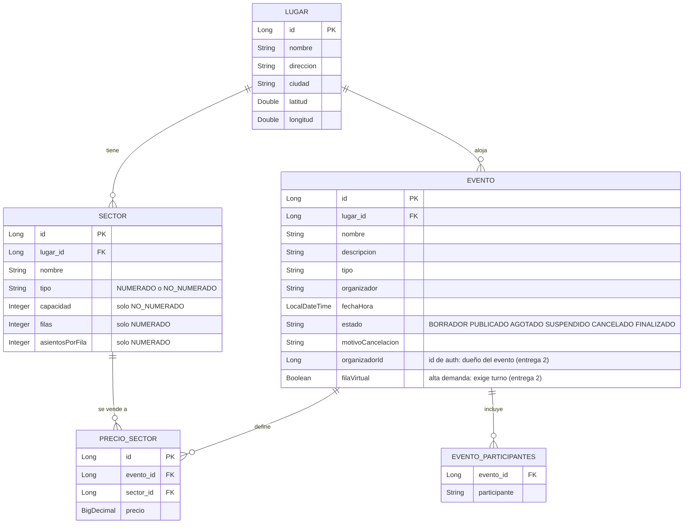
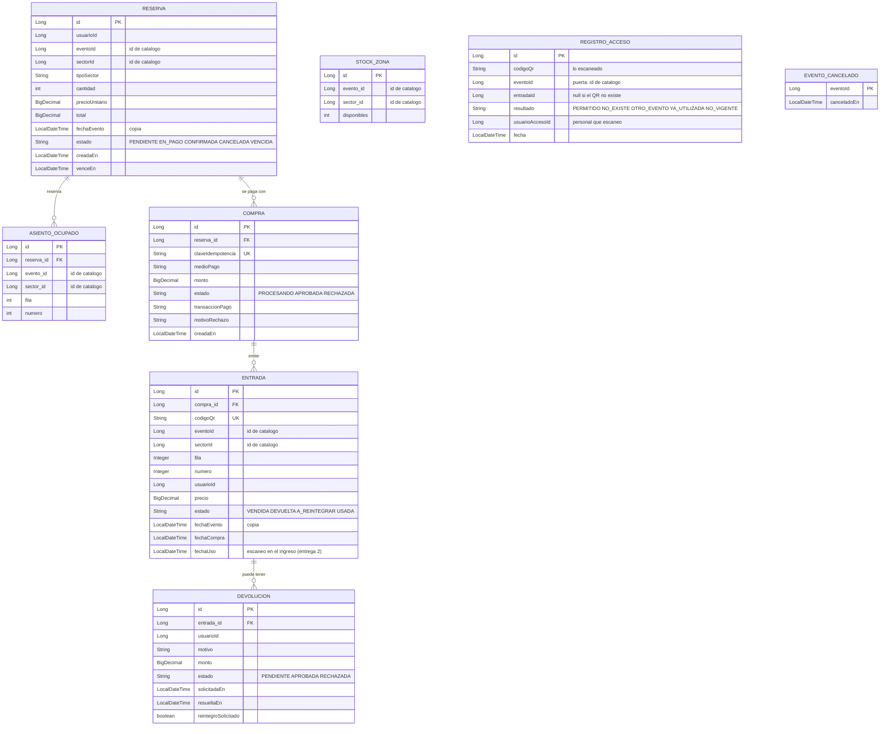
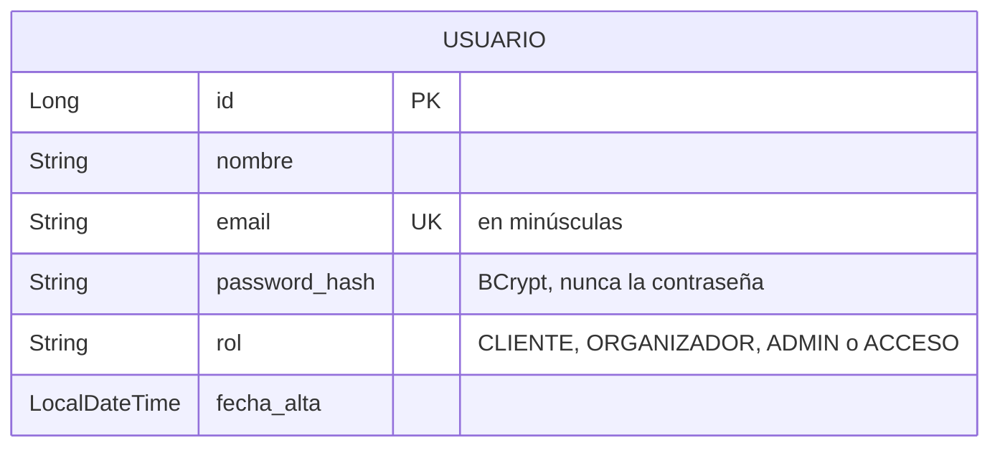

# Modelo de datos por microservicio

Cada servicio tiene su propia base de datos. Las relaciones **dentro** de un servicio son claves foráneas; las relaciones
**entre** servicios se guardan solo como el id del otro servicio, sin clave foránea (no se puede cruzar de una base a otra).

## catalogo-service



Restricción de unicidad: `PRECIO_SECTOR (evento_id, sector_id)` (un solo precio por sector en cada evento).

## ventas-service



Restricciones de unicidad que sostienen la garantía de no doble venta:

- `ASIENTO_OCUPADO (evento_id, sector_id, fila, numero)`: un asiento solo puede estar ocupado una vez.
- `STOCK_ZONA (evento_id, sector_id)`: una sola fila de cupo por zona (se modifica con bloqueo pesimista).
- `COMPRA (clave_idempotencia)`: un intento de pago por clave.
- `ENTRADA (codigo_qr)`: cada código QR es único.

## auth-service (entrega 2) · PostgreSQL



El `id` de `USUARIO` es el que viaja en el JWT y el que los demás servicios guardan como `usuario_id` / `usuarioId`.

## preferencias-service (entrega 2) · MongoDB, base `preferencias`

Un **documento por cliente** en la colección `perfiles`, con el historial de compras **embebido** (no hay JOINs):

```json
{
  "_id": 1,                                   // = id del usuario
  "version": 3,                               // control de concurrencia optimista (@Version)
  "ciudad": "Tandil",
  "ciudadNormalizada": "tandil",              // índice: búsqueda sin importar mayúsculas
  "tiposFavoritos": ["RECITAL"],
  "artistasFavoritos": ["Los Nuevos"],
  "artistasNormalizados": ["los nuevos"],     // índice multivalor
  "compras": [                                // historial, se agrega al consumir "compra.confirmada"
    { "compraId": 12, "eventoId": 1,          // índice en compras.eventoId (co-compra)
      "nombreEvento": "Recital de Prueba", "tipo": "RECITAL",
      "participantes": ["Banda Uno"], "ciudad": "Tandil", "fecha": "2026-11-16T11:30:00" }
  ],
  "actualizado": "2026-11-16T11:31:00"
}
```

| Índice | Para qué |
|---|---|
| `compras.eventoId` | "Quienes compraron este evento": base de la recomendación por co-compra. |
| `ciudadNormalizada`, `artistasNormalizados` | Encontrar a los fans de un artista en una ciudad cuando se publica un evento. |

## notificaciones-service (entrega 2) · MongoDB, base `notificaciones`

Un documento por aviso enviado, en la colección `notificaciones`:

```json
{
  "_id": "6738f2...",
  "usuarioId": 1,                                    // índice
  "tipo": "COMPRA_CONFIRMADA",                       // o EVENTO_CANCELADO, ARTISTA_FAVORITO
  "canal": "EMAIL",
  "titulo": "Compra confirmada",
  "mensaje": "Tu compra #12 de 2 entradas para \"Recital de Prueba\" fue confirmada...",
  "referencia": "compra:12",
  "claveIdempotencia": "COMPRA_CONFIRMADA:compra:12:1",   // índice ÚNICO: un mismo aviso sale una sola vez
  "estado": "ENVIADA",                               // o FALLIDA
  "fecha": "2026-11-16T11:30:01"
}
```

### ¿Por qué MongoDB para estos dos servicios?

| Criterio | Preferencias y notificaciones | Catálogo, ventas y auth |
|---|---|---|
| Forma de los datos | Perfil con listas de largo variable (favoritos, historial); avisos independientes entre sí | Entidades muy relacionadas (lugar, sector, evento, precio, reserva, entrada) |
| Transacciones | No hacen falta: cada escritura toca un solo documento (que en Mongo es atómica) | Imprescindibles: la compra y la no doble venta dependen de transacciones, bloqueos y restricciones de unicidad |
| Lectura típica | "Todo el perfil de este cliente" (un solo documento, sin JOINs) | Consultas con filtros y joins (búsqueda por ciudad, fechas, participante) |
| Evolución | Se agregan preferencias nuevas sin migrar un esquema | Esquema estable |
| Volumen | Una notificación por aviso: crece rápido y casi no se modifica (bitácora) | Moderado |

Se usa **una sola instancia de MongoDB** (la configuración provista por la cátedra) con **una base por servicio**
(`preferencias` y `notificaciones`): misma tecnología, esquemas separados, y ningún servicio lee la base del otro.

## fila-service (entrega 2) · Redis

No hay tablas: la fila es una estructura **en memoria** en Redis, con estas claves por evento `{e}`:

| Clave | Tipo | Contenido |
|---|---|---|
| `fila:{e}:espera` | Sorted set | usuario → número de llegada. La posición es `ZRANK + 1`; la tanda sale con `ZPOPMIN` (los primeros en llegar). |
| `fila:{e}:contador` | String (contador) | Número de llegada, con `INCR` atómico: el orden es el mismo aunque haya varias instancias. |
| `fila:{e}:turno:{u}` | String con TTL | El turno del usuario (token firmado). Vence solo a los 10 minutos. |
| `fila:{e}:habilitados` | String (contador) | Cuántos clientes se habilitaron en total. |
| `fila:{e}:lock-tanda` | String con TTL (`SET NX`) | Candado: una sola tanda por intervalo aunque haya varias instancias. |
| `fila:{e}:con-fila` | String con TTL 30 s | Cache de "el evento usa fila y está a la venta" (evita consultar a catálogo en cada ingreso). |
| `filas:activas` | Set | Eventos con gente esperando (los recorre el planificador de tandas). |

**¿Por qué Redis y no una base relacional o MongoDB?** En la apertura de una venta masiva entran miles de clientes por
segundo: Redis resuelve cada operación en memoria y en forma atómica, el sorted set da la posición en O(log n) y los
turnos vencen solos con el TTL. La fila es un dato efímero: si se pierde (reinicio), los clientes vuelven a entrar; las
compras ya hechas están en ventas, que es la fuente de verdad.

## Relaciones entre servicios y entidades solapadas

| Dato en ventas | Referencia a catalogo | Cómo se resuelve |
|---|---|---|
| `evento_id`, `sector_id` (en reserva, asiento, stock y entrada) | `EVENTO.id`, `SECTOR.id` | Solo el id, sin clave foránea. Los datos del evento y del sector se piden por HTTP al reservar. |
| `usuario_id` (ventas), `_id` del perfil (preferencias), `usuarioId` (notificaciones) | `USUARIO.id` (auth) | Solo el id: viaja en el JWT. |
| `compras.eventoId` (preferencias), `referencia` (notificaciones) | `EVENTO.id` (catálogo) | Solo el id; los datos se piden a catálogo al consumir el mensaje. |
| `EVENTO.organizadorId` (catálogo) | `USUARIO.id` (auth) | Solo el id, tomado del JWT de quien crea el evento. |
| Claves `fila:{e}:...` (fila) | `EVENTO.id` (catálogo), `USUARIO.id` (auth) | Solo ids; el turno firmado lleva usuario y evento. |

**Entidades solapadas entre bases:** ninguna entidad está duplicada. `Evento`, `Lugar` y `Sector` existen **únicamente**
en catálogo. Ventas guarda además **copias de valores puntuales** que necesita después, para no depender de catálogo:

| Copia en ventas | Origen | Motivo |
|---|---|---|
| `fechaEvento` (reserva y entrada) | `EVENTO.fechaHora` | Aplicar la regla de 72 horas de las devoluciones sin consultar a catálogo. |
| `precioUnitario` y `precio` | `PRECIO_SECTOR.precio` | Congelar el precio al momento de la compra: lo pagado no cambia si el organizador cambia la tarifa. |
| `tipoSector` | `SECTOR.tipo` | Saber cómo liberar los lugares (asientos o cupo) sin consultar a catálogo. |
| `compras[].tipo`, `participantes`, `ciudad`, `nombreEvento` (preferencias) | `EVENTO` y `LUGAR` (catálogo) | Recomendar sin consultar a catálogo por cada compra del historial. Es una copia del momento de la compra (consistencia eventual). |
